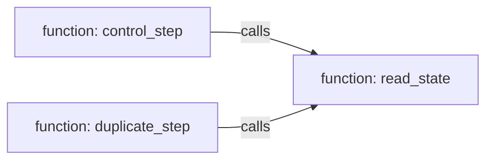
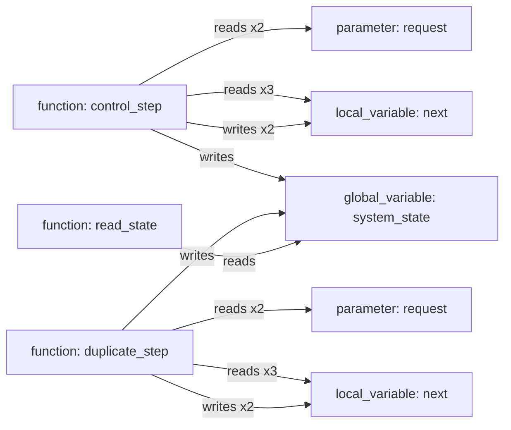
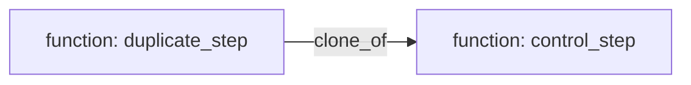

# Code-intelligence graph example

Generated from `tests/fixtures/code_intelligence/sample.c` by
`scripts/build_code_intelligence_example.py`. The JSON beside this file
contains the canonical graph and every currently executable projection.

## Call graph

## Variable-access graph

## Exact-token clone graph

## Complexity

| Function | Cyclomatic estimate | Statements | Method |
|---|---:|---:|---|
| control_step | 2 | 3 | ast_cyclomatic_v1 |
| duplicate_step | 2 | 3 | ast_cyclomatic_v1 |
| read_state | 1 | 1 | ast_cyclomatic_v1 |

## Memory estimate

- Global typed storage: 4 bytes.
- Local/parameter totals are compiler type-size sums, not stack frames.
- Linker sections, addresses, padding, heap, and runtime peaks remain
  unavailable.

## Evidence boundary

CFG, data flow, state/scheduler/interrupt semantics, requirements/tests,
timing, exact stack/linker memory, and failure propagation remain gated
by the engines or external evidence named in
`docs/contracts/graph-capabilities.md`.
